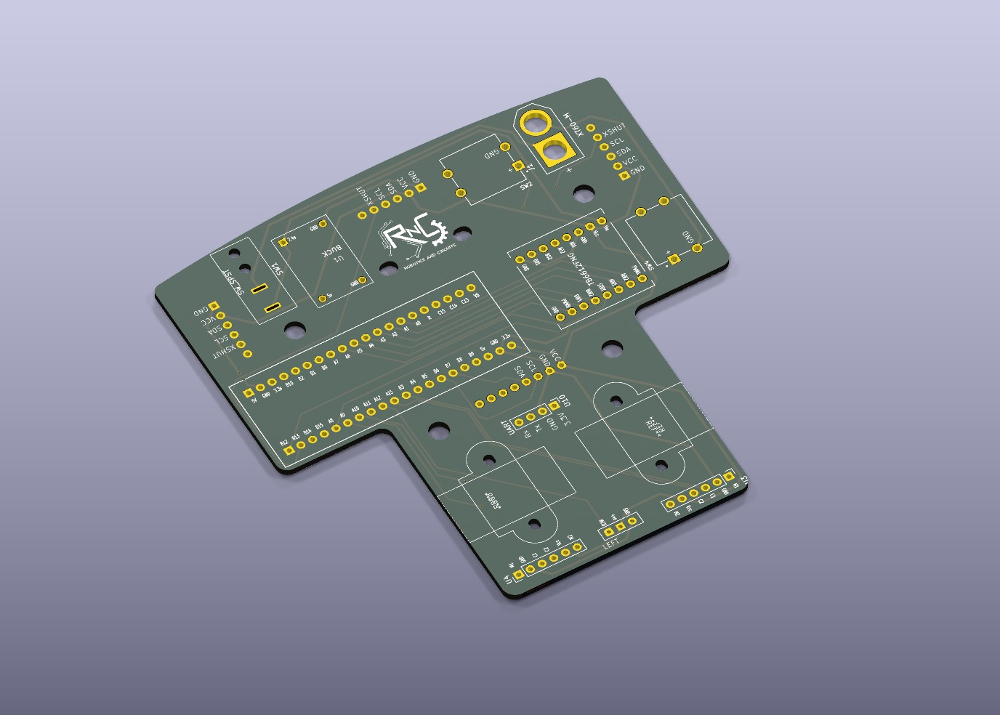
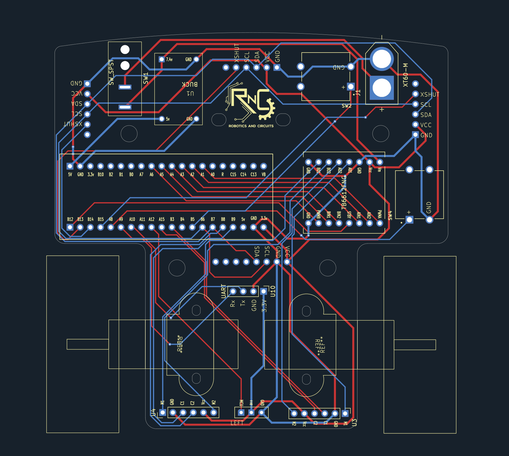
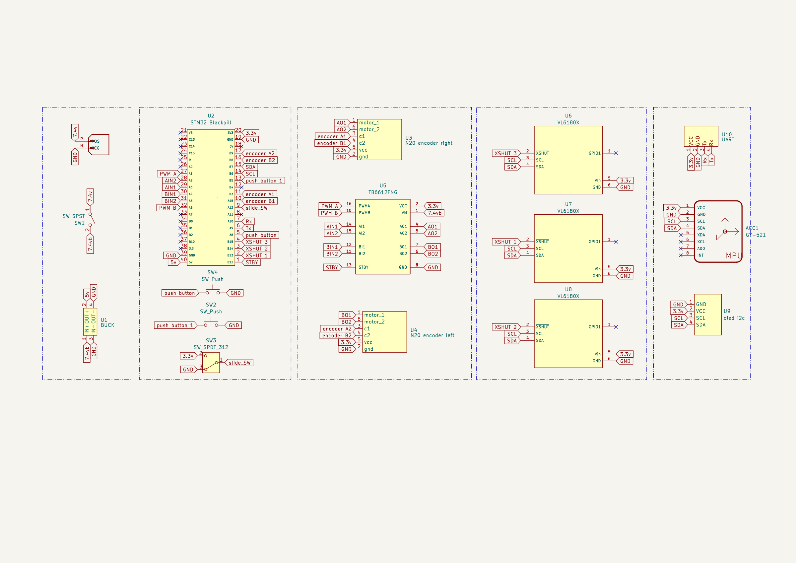
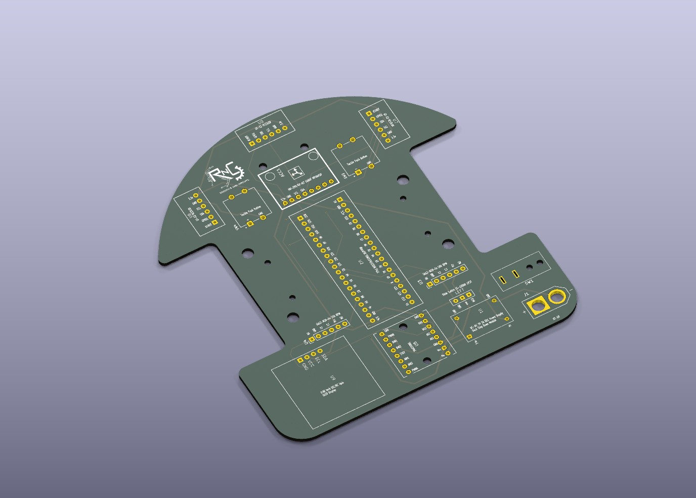
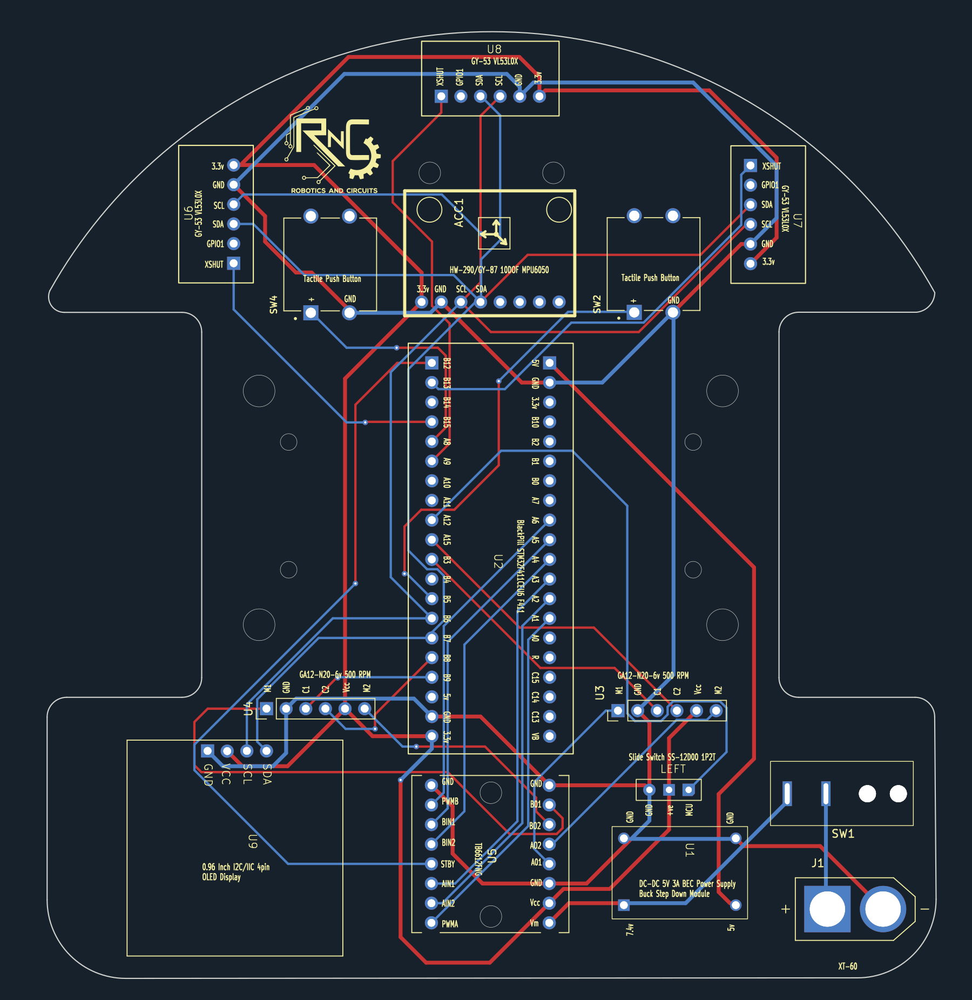
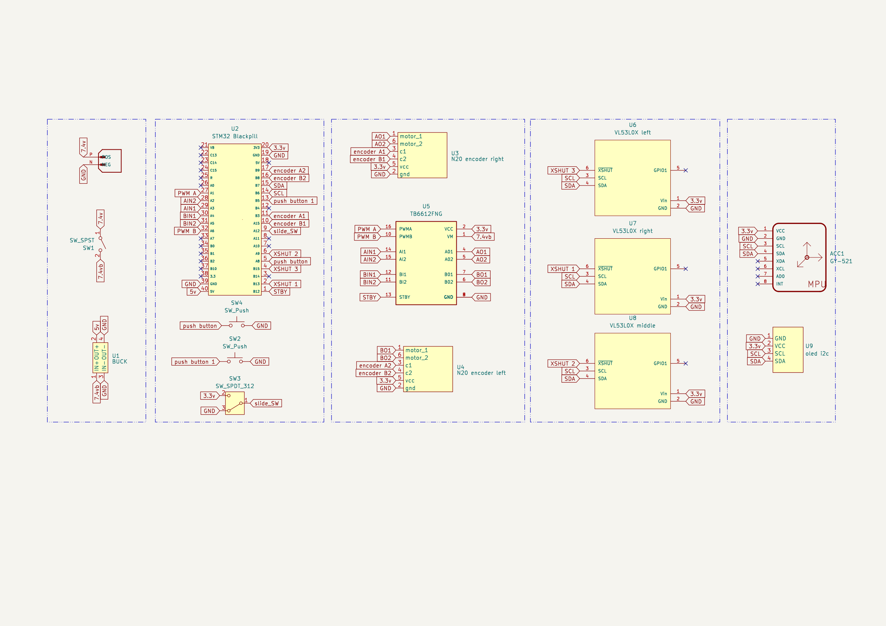

# Micromouse PCB Designs

Two KiCad PCB iterations for an autonomous maze-solving robot, with schematics, routed board layouts and native 3D board previews.

## Design previews

The images below are generated directly from the unchanged KiCad source files using **KiCad 9.0.2**. They are design renders, not photographs of fabricated hardware. Click any preview to inspect it at full resolution.

### Version 2

*Native 3D board view. External component models are not included in this public source copy, so this is a bare-board preview rather than a populated assembly.*

| Routed PCB layout | Schematic |
| --- | --- |
|  |  |

### Version 1

*Native 3D board view, with the same external-model limitation.*

| Routed PCB layout | Schematic |
| --- | --- |
|  |  |

The PCB plots overlay front copper (red), back copper (blue), front silkscreen and board edges; they are not manufacturing artwork. Schematic previews show the source sheet without its drawing frame. PCB and schematic PNGs were rasterized from native KiCad SVG exports using Inkscape. Missing 3D models have not been substituted. See the source files for editable and zoomable design details.

## Open a version

| Version | Project | Schematic | Board |
| --- | --- | --- | --- |
| Version 1 | [Project](Version1/micromouse.kicad_pro) | [Schematic](Version1/micromouse.kicad_sch) | [PCB](Version1/micromouse.kicad_pcb) |
| Version 2 | [Project](Version2/micromouse.kicad_pro) | [Schematic](Version2/micromouse.kicad_sch) | [PCB](Version2/micromouse.kicad_pcb) |

Both board files identify KiCad 9.0 as their generator. Install a compatible KiCad version and the appropriate standard libraries. The six native files are byte-identical to the supplied design files: no connectivity, geometry, symbol, footprint, or source-attribution field was edited for publication.

## Deliberately omitted

- Downloaded 3D models and separate symbol/footprint library collections whose individual provenance was not fully documented.
- Historical ZIPs, manufacturing outputs, backups, editor history, local editor state, caches, lock files, original screenshots, and the component workbook. The `assets/` folder contains newly generated source-based previews only.
- Original upload archives and private preservation copies.

The board and schematic files already contain embedded symbol/footprint data. Updating those items from external libraries may require local library configuration; no `sym-lib-table` or `fp-lib-table` was supplied. Version 1 references `KICAD8_3DMODEL_DIR`; version 2 references `KICAD9_3DMODEL_DIR` and project-relative 3D files. Missing model files are intentional in this public copy. No placeholders or substitute electrical parts have been added.

## Attribution and limits

See [THIRD_PARTY.md](THIRD_PARTY.md) for the known SnapMagic/SnapEDA and KiCad sources and their design exceptions. Source links embedded in the native files remain intact. Some custom blocks do not carry an independent author/source record; this preparation is not a comprehensive ownership or legal-clearance determination. No blanket license has been assigned to all project content.

KiCad successfully loaded the files for these renders. No ERC, DRC, fabrication, assembly, or hardware test was run for this documentation update; successful rendering is not electrical or manufacturing validation. The files are design sources, not a certified manufacturing release.
